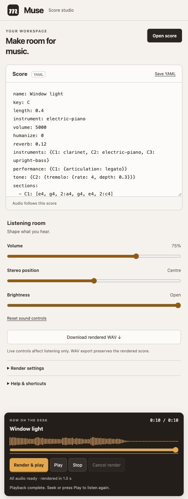

# Muse

Muse turns music scores written in YAML into stereo WAV files. It uses nothing but Go and some simple maths: every note is built from sine waves, either shaped by an envelope and coloured by harmonics, or synthesised whole by an instrument (acoustic, electric and electronic instruments), with a synthesised drum kit to keep time. A score is then played the way a person would play it, with dynamics, phrasing, loose timing, stereo placement and a room, unless you ask for it exactly as written.

It also comes with `muse-convert`, which turns sheet music (images or PDFs) into scores using Claude's vision.

You can use it as a command-line tool, or as a web app where you write a score, listen to it, download it and share it.

The design is explained in these articles:

- [Make Music With Maths and Go (Part I)](https://medium.com/geekculture/make-music-with-maths-and-go-i-abfdbcf73b65): generating notes from sine waves, envelopes and harmonics
- [Make Music With Maths and Go (Part II)](https://medium.com/geekculture/make-music-with-maths-and-go-ii-7d49d438b83c): the score format, the CLI and web app, and sharing through Open Graph

## Editing expressive scores

For new scores, use [Muse 2 notation](docs/notation-v2.md): named tracks, reusable
patterns, section variants and a musical playback order. Start with the
[short example](scores/notation_v2_demo.yaml) or the complete
[The Living Years](scores/the_living_years_expressive.yaml).

The earlier [phrase format](docs/editable-scores.md), demonstrated by
[Misty Final](scores/misty_final.yaml), and legacy scores remain supported.
To inspect a score without rendering, run
`go run ./cmd/muse -expand /tmp/expanded.yaml scores/notation_v2_demo`.

## Quick start

Requires Go 1.26 or later.

```shell
git clone https://github.com/sausheong/gomuse
cd gomuse

go run ./cmd/muse scores/scale   # writes scores/scale.wav from scores/scale.yaml
go run ./cmd/muse -s             # starts the web app on http://localhost:8888
```

Or use the Makefile (`make help` lists every target):

```shell
make build              # builds bin/muse
make run SCORE=scores/tears
make serve              # web app on :8888, tunes stored in ./data
make render             # renders every sample score to scores/*.wav
make build-convert      # builds bin/muse-convert, the sheet music converter
make convert PAGES="notation/misty_*.jpeg" OUT=scores/misty.yaml
make check              # gofmt check, go vet and tests
make build-linux        # static linux/amd64 binary for deployment
```

The templates, static files and sample scores are built into the binary, so `bin/muse` runs from any directory.

## How it works

Each note is turned into 16-bit samples at 44.1 kHz. With an envelope and a harmonic:

```
sample(t) = volume × envelope(t, duration) × harmonic(frequency × t)
```

An instrument instead synthesises the whole note at once, so each overtone can change on its own over the note (see [Instruments](#instruments)).

- **Frequency** uses equal temperament, counted in semitones from A4 (440 Hz): `frequency = 440 × 2^(n/12)`. For example, `a4` is 440 Hz and `c4` is 9 semitones below it, about 261.6 Hz.
- **Envelope** shapes the note's loudness over its duration, for example a fade-out (`drop`) or a swell (`round`).
- **Harmonic** adds overtones to the fundamental frequency to change the timbre.
- **Chords** are the samples of their notes added together.
- **Expression:** unless a score sets `plain: true`, it's played the way a person would play it, not exactly as written: louder and softer with the [dynamics](#dynamics) and crescendos you mark, with accents and phrasing, notes that ring into each other, loose [timing](#timing) that slows for a ritardando or holds a fermata, the parts [placed across the stereo field](#parts-and-stereo-placement), and a room around it all (see [Expression](#expression)).
- **Channels:** a score has up to three pitched channels, `C1`, `C2` and `C3`, usually the melody, the accompaniment and the bass, plus an optional [drum part](#drums). They're placed across the stereo field (the melody and the drums in the middle) and mixed into a stereo WAV; a `plain` score instead puts `C1` on the left, `C2` on the right and `C3` and the drums in the centre (see [Parts and stereo placement](#parts-and-stereo-placement)). Samples are clamped to the 16-bit range, so loud chords clip rather than wrap around.

## Command-line tool

```shell
muse <path/to/score>    # without the .yaml extension
```

This reads `<score>.yaml` and writes `<score>.wav` next to it, relative to the current directory. On success it prints the tune's name and how long it took. On failure it prints the error to stderr and exits with a non-zero status. There's no length limit on the command line.

## Web app

```shell
muse -s [-addr 0.0.0.0:8888] [-data data]
```

| Flag | Default | Meaning |
|---|---|---|
| `-s` | off | Start the web app instead of rendering a score |
| `-addr` | `0.0.0.0:8888` | Address to listen on |
| `-data` | `data` | Folder for generated tunes and their scores |

| Route | What it does |
|---|---|
| `GET /` | Score editor with links to the sample scores |
| `GET /sample/{name}` | Opens `scores/{name}.yaml` in the editor |
| `POST /create` | Renders the score, then shows a player, download link and share link |
| `GET /share/{id}` | Public page for a tune, with Open Graph `music.song` tags for social previews. Their URLs use the scheme and host the page was requested on (`X-Forwarded-Proto: https` is honoured behind a proxy), so previews work on any domain |
| `GET /static/...` | Embedded CSS, JS and images |
| `GET /static/tunes/{id}.wav` | Generated tunes, served from the data folder |

- **Where files go:**
  - Generated tunes are saved as `<data>/tunes/<id>.wav`, and their scores as `<data>/scores/<id>.yaml`. Both folders are created when the server starts. The default `data/` folder is ignored by git.
  - Tunes keep their `/static/tunes/<id>.wav` URLs, so share links from earlier versions still work.
  - **Upgrading an existing deployment:** tunes used to be stored in `static/tunes/` and `static/scores/` next to the binary. Move them to `<data>/tunes/` and `<data>/scores/` so old share links keep working.
- **Re-creating a tune:** pressing "re-create" overwrites the same tune, but only if your browser holds the signed edit cookie it received when the tune was created. Anyone else, or anyone after a server restart, gets a new tune with a new ID. Shared links can't be used to overwrite someone else's tune.
- **Limits:**
  - Requests are capped at 256 KiB.
  - Each channel can have at most 6,000,000 samples (about 2 minutes 16 seconds). The length is checked before any audio is generated.
  - A chord can have at most 16 notes.
  - Longer tunes can be rendered with the command-line tool.
- **Security:** all output is HTML-escaped, and tune IDs and sample names are validated before they're used in any file path.

## Bundled browser player

The **Score studio** renders and plays Muse scores entirely in your browser.
The Go synthesis engine runs as WebAssembly in a background worker, while an
AudioWorklet plays the generated stereo audio. Scores stay local. The standalone
player needs no rendering backend.

<p align="center">
  
</p>

- Edit YAML and see when the score differs from the rendered audio.
- Seek, pause, resume or stop from a persistent transport with a real waveform.
- Adjust live volume, stereo position and brightness without changing exports.
- Start playback after a short buffer, or wait for the full render to include
  whole-song RMS mastering.
- Download YAML and stereo 44.1 kHz, 16-bit WAV files locally.
- Use Command/Ctrl + Enter to render, or Space outside controls to pause/resume.
- Expand render settings and help as needed; the layout adapts to narrow screens.

### Run with the Muse web app

```shell
make serve
```

Open `http://localhost:8888/player`, or choose **Play in browser** from the
existing score editor to carry its current contents into the studio.
`make build` and `make build-linux` also build and embed the player assets.

### Run as a standalone static player

```shell
make player-bundle
python3 -m http.server 8000 --bind 127.0.0.1 --directory bin/player
```

Open `http://localhost:8000`. Deploy the contents of `bin/player` to any HTTPS
static host to use it without a Go server. AudioWorklet requires localhost or
HTTPS; opening the HTML directly as a file is unsupported. The player has no
service worker or persistent offline cache.

Go is needed to build the bundle, not to use it. Generated `muse.wasm` and
`wasm_exec.js` are ignored by Git and rebuilt together with `make player`.
Run that target first if building the web app directly with `go build`.

Browser scores are limited to 2 MB and ten minutes of written/performed music,
with an additional synthesis-work limit. Progressive mode omits whole-song
mastering and can retain extra trailing silence. Long notes may delay a block;
scat vocals need preparation, and neural singing requires the local CLI.
See the [browser player guide](docs/browser-player.md) for details.

## Score format

A score is a YAML document:

```yaml
name: C major scale with C major chord progression
key: C
length: 0.5        # seconds per beat
envelope: round
harmonic: first
volume: 5000
sections: [
  {
    envelope: drawl,        # section overrides
    volume: 2000,
    C1: [c4, d4, e4, f4],
    C2: [2:c4-e4-g4, 2:f4-a4-c4],
  },
  {
    harmonic: second,
    C1: [g4, a4, b4, c5],
    C2: [2:g4-b4-d4, 2:z],
  }
]
```

The same format scales up to a performance. This one gives the melody to a saxophone over a piano, marks the dynamics, swells into the second bar, and slows down and holds the last chord:

```yaml
name: Expressive example
key: F
length: 0.75            # 80 beats a minute
instrument: piano
instruments: {C1: sax}  # the melody on saxophone
levels: {C2: 0.5, C3: 0.45}
volume: 20000
sections:
  - dynamic: p
    hairpin: cresc      # grows to the next section's f
    C1: [c5, 0.5:a4, 0.5:b4, 2:c5]
    C2: [4:f3-a3-c4]
    C3: [2:f2, 2:c3]
  - dynamic: f
    C1: [d5, 0.5:c5, 0.5:b4, 2:a4]
    C2: [2:f3-b3-d4, 2:f3-a3-c4]
    C3: [2:b1, 2:f2]
  - dynamic: mp
    ritardando: 0.3     # slows down through the bar...
    fermata: 2          # ...and holds the end two beats longer
    C1: [4:f4]
    C2: [4:f3-a3-c4]
    C3: [4:f2]
```

### Fields

| Field | Level | Meaning |
|---|---|---|
| `name` | score | Title shown in the web app and share previews |
| `key` | score | Key signature (see below) |
| `length` | score, section | Length of one beat in seconds |
| `envelope` | score, section | Envelope name (see below) |
| `harmonic` | score, section | Harmonic name (see below) |
| `instrument` | score, section | Instrument name (see below). Replaces `envelope` and `harmonic`, which can then be left out |
| `volume` | score, section | Peak amplitude of a single note. Every envelope and harmonic peaks at 1, so a note never exceeds `volume`. Chord notes add up, so keep `volume × notes in the largest chord` below 32767 to avoid clipping |
| `reverb` | score | Amount of room reverb, from `0` (none) to `1`. Defaults to `0.25` |
| `plain` | score | `true` plays the score exactly as written: no ring-over, accents, balance, dynamics, timing changes, panning or reverb |
| `humanize` | score | Small random timing variation, from `0` (none) to `1`. Defaults to `0.5` |
| `swing` | score | Swing for off-beat eighths, from `0` (straight) to `1` (triplet feel) |
| `instruments` | score, section | An instrument per channel, e.g. `{C1: voice}` |
| `pan` | score | Stereo position per channel (`C1`, `C2`, `C3` or `drums`), from `-1` (left) to `1` (right), e.g. `{C1: 0}` |
| `levels` | score | Loudness per channel (`C1`, `C2`, `C3` or `drums`), from `0` to `1`, e.g. `{C2: 0.6, drums: 0.7}`. Replaces the default balance, and applies even when `plain` |
| `dynamic` | section | Dynamic marking: `ppp pp p mp mf f ff fff`. Lasts until the next one |
| `hairpin` | section | `cresc` or `dim`: moves smoothly towards the next section's dynamic |
| `ritardando` | section | Slows the section gradually: `0.2` ends it 20% slower. Negative speeds up |
| `fermata` | section | Holds the end of the section this many beats longer |
| `sections` | score | List of sections, played in order |
| `C1`, `C2` | section | Notes for the left and right channels |
| `C3` | section | Optional notes for a third channel |
| `drums` | section | Optional drum part: the drums struck on each beat, e.g. `[0.5:kick-hat, 0.5:hat]` (see [Drums](#drums)) |

A section inherits every setting it doesn't set itself from the score. If `C2` and `C3` are empty everywhere, `C1` plays on both sides. A score can also be a drum part alone. All channels should be the same length; a difference under 1,500 samples (about 34 ms) is padded with silence, and anything bigger is an error. Each section is best kept to one bar: accents and dynamics follow sections, so a long section only gets one strong downbeat.

### Notes

A note is `<letter><octave>[accidental]`:

- **Letter:** `a` to `g`, lowercase.
- **Octave:** `1` to `7`. `c4` is middle C and `a4` is 440 Hz.
- **Accidental:**
  - `#` sharp, e.g. `f4#`
  - `b` flat, e.g. `b3b`
  - `n` natural, e.g. `f4n`

Other building blocks:

| Syntax | Meaning |
|---|---|
| `z` | A rest |
| `2:c4` | Scales the note's length relative to the beat. Any positive number works, e.g. `0.5:e4` or `0.33:g4` |
| `c4-e4-g4` | A chord: notes joined with `-` play together, up to 16 notes. Each note can have its own accidental, e.g. `c4#-e4-g4#` |
| `3:a3-d4-f4` | A length prefix applies to the whole chord |

### Key signatures

Supported keys: `C`, the sharp keys `G D A E B F# C#`, and the flat keys `F Bb Eb Ab Db Gb Cb`.

The key signature applies to every octave. A note written without an accidental follows the key: in `D`, `f4` plays F♯. A written accidental replaces the key's accidental for that note, so it never adds to it:

- `f4n` plays F natural.
- `f4#` plays F♯.
- `f4b` plays F♭.

### Instruments

An instrument synthesises each note as a whole instead of combining an envelope with a harmonic. That lets every overtone change at its own rate: in a real plucked or struck string the high overtones die away much faster than the fundamental, so the note starts bright and turns mellow; in a horn they grow faster as the player blows harder. Like envelopes, every instrument peaks at 1 and ends at 0.

All instruments are used the same way: as the score's `instrument`, a section's `instrument`, or one channel's, with `instruments: {C1: sax, C3: bass}` (see [Parts and stereo placement](#parts-and-stereo-placement)).

| Name | Family | Sound |
|---|---|---|
| `trombone` | brass | Lower brass body, rounded tongue attack and velocity-dependent upper harmonics; useful around E2–B4 |
| `french-horn` | brass | Warm low-mid resonances and a gradual attack; useful around B1–F5 |
| `oboe` | double reed | Nasal upper-mid resonances, light reed noise and delayed vibrato; useful around Bb3–A5 |
| `bassoon` | double reed | Low reed body with a concentrated midrange resonance; useful around Bb1–E4 |
| `string-ensemble` | bowed strings | Five detuned bow voices with different attacks, noise seeds and vibrato depths; supports chords |
| `nylon-guitar` | plucked strings | Soft pluck, low string stiffness and a darker body than steel-string guitar; supports guitar performance controls |
| `glockenspiel` | mallets | Bright metal-bar modes and ringing decay |
| `xylophone` | mallets | Hard wooden-bar attack and rapidly decaying upper modes |
| `tubular-bells` | mallets | Long-lived, inharmonic tube modes around a perceived strike pitch |
| `violin` | bowed strings | Solo bowed tone with gradual bow engagement, body resonances, quiet friction noise and delayed vibrato; useful around G3–E6 |
| `cello` | bowed strings | Darker body resonances and a slower bow attack; useful around C2–C5 |
| `synth-bass` | electronic | Tight attack, strong fundamental and quickly decaying upper harmonics; useful around C1–C4 |
| `synth-lead` | electronic | Bright, mildly detuned oscillators and an articulated attack; useful around C3–C6 |
| `synth-pad` | electronic | Slow swell, gently detuned oscillators and sustained harmony; useful around C2–C6 |
| `upright-bass` | plucked strings | Pizzicato acoustic bass, with body resonances and a shorter initial decay than electric bass; useful around E1–G3 |
| `harp` | plucked strings | Lightly stretched harmonics, a clear pluck and longer low-register decay; useful around C2–C7 |
| `marimba` | mallets | Soft wooden-bar strike, tuned and inharmonic modes and a shorter decay than vibraphone; useful around C3–C6 |
| `electric-piano` | keyboards | Tine-inspired warmth, register-dependent tine modes, a fading bell attack and stronger pickup harmonics on harder strikes |
| `organ` | keyboards | Fixed drawbar registration, steady sustain and a brief filtered key-contact transient; optional drawbars and rotary modulation via `tone` |
| `vibraphone` | mallets | Tuned and inharmonic bar modes, long decay and gentle 5 Hz tremolo |
| `flute` | woodwinds | Fundamental-rich tone, breath noise, soft tonguing and delayed vibrato |
| `clarinet` | woodwinds | Strong odd harmonics in the low register, fuller even harmonics higher up and a restrained reed attack |
| `piano` | strings (struck) | A hammered string. The hammer strikes a seventh of the way along and its felt softens the top. Above the bass, two strings, then three in the middle and upper registers, beat gently against each other. Hammer hardness changes the upper partials with velocity. Each overtone decays in two stages (a quick drop, then a long tail), and higher notes die away faster |
| `guitar` | strings (plucked) | A plucked steel string. Plucked a fifth of the way along, so every 5th overtone is missing. Broad body resonances colour the strings and stronger plucks excite more high-frequency energy. The overtones run very slightly sharp, and higher ones fade faster |
| `electric-guitar` | strings (plucked) | Picked electric guitar with sustained harmonics and a mildly driven amp colour, built from band-limited partials; useful for rock riffs and instrumental melody |
| `bass` | strings (plucked) | An electric bass guitar played with the fingers. Thick strings, so the overtones run sharper; plucked over the neck pickup, whose roll-off opens with stronger finger attacks. A long, steady fundamental under quickly fading overtones, so a bass line sits under everything without getting in the way. At home from E1 to G3 |
| `voice` | voice | A sung "ah": a glottal buzz shaped by warm vowel formants (about 650, 1080 and 2650 Hz). It fades in softly, holds the pitch steady for the first 0.2 s, then grows a vibrato (about 5.5 Hz, ±45 cents), with a slight drift and shimmer and a touch of breath at the onset |
| `trumpet` | winds (brass) | A bright brass tone. Tongued firmly, starts a little under the note as the lips find the pitch, and is mostly played straight, with only a touch of vibrato on long notes |
| `saxophone` (or `sax`) | winds (reed) | A darker, reedy tone with a nasal colour. Slides up into each note, sings with a clear vibrato, and the breath is heard all through the note |

```yaml
instrument: piano     # instead of envelope and harmonic
sections:
  - C1: [d5, e5, f5]
  - instrument: guitar   # a section can switch instrument
    C1: [a4, b4, 2:c5]
```

How they're built, by family:

- **Strings** (`internal/muse/strings.go`): a string set ringing and left to die away. Each note is a list of fixed partials (sine components with a frequency, a level and one or more exponential decay stages), and the pluck or strike position decides which overtones are strong.
- **Voice** (`voice.go`) and **winds** (`winds.go`): sustained tones whose pitch moves (a scoop into the note, vibrato), so they follow the fundamental's phase and derive the overtones from it. In the winds, blowing harder doesn't just make the note louder, it makes it brighter, so each note starts dark and opens up as it swells.

To add an instrument, write a function `func(freq, duration float64) []float64` that returns `sampleCount(duration)` samples peaking at 1 and ending at 0, register it in the `instruments` map in an `init` function, and give it a ring-over time in `releases`. The shared pieces are in `instrument.go`.

The pitched instruments other than `voice` receive the existing dynamic velocity during synthesis, without a second generic tone filter. Scores without dynamics use a moderate strike/breath strength. The `organ` registration stays constant with velocity; dynamics still change its loudness. These instruments now damp from note-off rather than sustaining throughout their release allowance. Singing synthesis keeps its previous rendering path. These are procedural approximations, not sampled instruments.

`keyboards.go` provides an optional `velocityInstrument` renderer and `registerVelocityInstrument` helper. `woodwinds.go` supplies the flute and clarinet presets. The optional `tone` controls add electric-piano tremolo and organ drawbars with a mono rotary approximation. Piano, guitar and bass now shape their excitation with velocity; trumpet and saxophone vary their breath pressure and tonguing before mixing. The original-instrument comparison is in `examples/instruments/existing-quality/`, with preserved before/after audio and RMS-matched listening copies.

Listen to `scores/instrument_palette.wav`, generated from `scores/instrument_palette.yaml`: the first keyboard, mallet and woodwind additions play alone, followed by three short ensemble passages. The exposed phrases include low, middle and high notes, repeated notes and contrasting dynamics.

The second palette is `scores/instrument_palette_2.yaml` and its rendered WAV. Each of the eight new presets plays a soft and loud solo phrase, followed by chamber, electronic and plucked/mallet ensemble passages. The suggested ranges above describe intended colour, not enforced pitch limits.

- **Bowed strings** (`bowed.go`) sustain a body-shaped harmonic bank with bow engagement, delayed vibrato and filtered friction noise. Violin and cello are solo-note approximations; the optional phrase renderer supports connected bowing and portamento, while `string-ensemble` layers five independent detuned bow voices. This does not simulate individual orchestral seating or section bowing.
- **Electronic instruments** (`synth.go`) sum a bounded number of harmonics, checking each detuned partial against the synthesis frequency ceiling. Harmonic envelopes change brightness over time; optional editable patches in `tone_controls.go` add oscillator waveforms, envelopes and a linear resonant low-pass filter. Nonlinear analogue saturation is not modelled.
- **Acoustic plucks and bars** (`acoustic.go`) provide pizzicato upright bass, harp and marimba. They respond to dynamics and note-off damping. Harp sympathetic coupling across notes and alternate upright-bass articulations are not modelled.

For example, `instruments: {C1: violin, C2: harp, C3: cello}` creates a chamber trio; use `{C1: synth-lead, C2: synth-pad, C3: synth-bass}` for an electronic arrangement.

### Stateful phrase performance

Existing scores keep their original renderer. Opt a monophonic clarinet, flute, trumpet, saxophone, violin, cello or synth-lead channel into the phrase renderer with `performance`, at score or section level:

```yaml
instruments: {C1: clarinet, C2: electric-piano, C3: bass}
performance:
  C1: {articulation: legato, swell: 0.35, vibrato: 3}
```

`articulation` accepts `legato`, `detached` (85% gate) or `staccato` (50% gate). Release follows the gate and can overlap the following note. `swell` is 0–1: it arches loudness and brightness within each note. `vibrato` is 0–30 cents of delayed pitch modulation. Both default to zero. These are per-channel section settings, not inline note annotations.

Consecutive legato notes on the same instrument retain oscillator phase, filtered noise, harmonic state and vibrato time. Pitch and dynamics change smoothly at their boundary. Rests, an instrument change or a non-legato articulation end the connection; timing remains on the existing tempo grid. Small humanisation gaps are bridged, but gaps of 40 ms or more are not. Phrase dynamics already supplied by `dynamic` and `hairpin` still apply.

Section entries replace score entries, so `performance: {C1: {}}` disables the new renderer for that section. Unsupported instruments and invalid values produce errors; sustained performance requires monophonic parts. The original `voice` instrument and singing backends are unchanged. This is a continuous harmonic voice model, not a physical bow/reed simulation; arbitrary automation beyond the phrase curves below remains future work.

Render `scores/how_deep_is_your_love_expressive.yaml` for the phrase-performance version. Its source arrangement and all its musical events are preserved in `scores/how_deep_is_your_love_chamber_pop.yaml`.

### Instrument tone controls

Optional `tone` maps at score or section level configure C1, C2 and C3. A section entry replaces the score entry for that channel; `{}` restores the default sound. Controls are explicit and validated for the selected instrument. Existing scores retain their default timbres.

```yaml
instruments: {C1: organ, C2: electric-piano, C3: synth-bass}
tone:
  C1:
    drawbars: [8, 0, 8, 4, 0, 0, 0, 0, 0]
    rotary: {rate: 5.5, depth: 0.7}
  C2:
    tremolo: {rate: 4, depth: 0.6}
  C3:
    synth:
      wave: square
      detune: 3
      attack_ms: 8
      release_ms: 180
      cutoff: 600
      resonance: 2
      filter_envelope: 2.5
      filter_decay_ms: 220
```

- **Organ drawbars:** nine levels from 0 to 8, ordered 16′, 5⅓′, 8′, 4′, 2⅔′, 2′, 1⅗′, 1⅓′, 1′. Zero turns a bar off; at least one must be audible. The rendered registration is peak-normalised. Custom drawbars omit the default key-contact transient.
- **Organ rotary:** `rate` is 0.1–12 Hz and `depth` is 0–1. A mono fractional-delay Doppler effect and amplitude shading approximate a rotor. LFO phase follows score time; this is not a stereo Leslie cabinet or an acceleration simulation.
- **Electric-piano tremolo:** the same rate/depth ranges control amplitude modulation, with phase shared across chord notes and continuous in score time.
- **Synth patch:** available on `synth-bass`, `synth-lead` and `synth-pad`. `wave` accepts `sine`, `triangle`, `square` or `saw`. `detune` spans 0–30 cents either side of the centre oscillator. `attack_ms` is 0–2000; `release_ms` is 0–3000. The explicit release is included in rendering resource limits.
- **Synth filter:** `cutoff` is 40–18000 Hz; `resonance` is Q from 0.5–8. `filter_envelope` is an initial offset of −4 to +4 octaves, decaying towards the cutoff over `filter_decay_ms` (1–5000 ms). Positive values close the filter; negative values open it. Resonance is bounded and the result normalised. Patches currently use independent note rendering and reject sustained `performance` rather than silently bypassing the patch.

Omitted patch fields default to a saw wave, preset-specific detune and attack, the instrument's release, a velocity-dependent cutoff, Q 0.707, zero filter envelope and 350 ms filter decay. These controls do not introduce reusable named patch definitions or arbitrary automation.

The new winds (`trombone`, `french-horn`, `oboe`, `bassoon`) support the existing monophonic legato, detached and staccato performance, vibrato, breath and tongue controls. Trombone and French horn also accept falls. Nylon guitar supports strums, let-ring, palm-mute, slides and hammer-ons. The string ensemble supports ordinary polyphonic notes, with its own attacks and releases, rather than the solo bowed phrase renderer.

Listen to `scores/instrument_palette_3.wav` for all nine added pitched instruments, eight added percussion sounds and three ensemble passages. `scores/tone_controls_demo.wav` demonstrates drawbars, rotary, tremolo and synth patches. Their editable YAML files use original audition phrases. See [palette expansion validation](docs/palette-expansion.md) for coverage and measured audio.

### Per-note accents and multi-note phrase swells

Each section can set `expression` independently for C1, C2 and C3. Event numbers are **one-based and count rests**; a chord is one event. Accents are dB offsets applied to loudness and synthesis velocity. Use positive values for emphasis and negative values for softer touch. They combine with existing dynamics and humanisation.

```yaml
expression:
  C1:
    accents: {1: 1.5, 2: -1, 5: 2}
    phrases:
      - {from: 1, to: 8, start_db: -2, peak_db: 1, end_db: -3, peak_at: 0.6}
```

A phrase smoothly interpolates loudness from the start of `from` through its peak to the end of `to`, using performed time including tempo changes and fermatas. `peak_at` defaults to 0.5 and otherwise must be greater than zero and less than one. Swells continue across note boundaries and rests; release tails retain the ending level. Phrase ranges must be ordered and non-overlapping within each channel and section. All dB offsets must be finite and between -12 and +6. Unspecified events retain their existing touch; absent or empty expression leaves the previous output unchanged. Explicit expression also works with `plain: true`.

These phrase curves control amplitude, while accents also affect the instrument's available velocity response. For supported sustained instruments, optional phrase `tone` curves also shape harmonic brightness, as described below. The earlier `performance.swell` still adds a separate swell within each note; set it to zero when only the multi-note arch is wanted. Positive accents and phrase peaks add together, so leave mix headroom.

`scores/how_deep_is_your_love_phrase_shaped.yaml` preserves the acoustic arrangement's musical events, adds melody accents and phrase arches, softens passing notes and varies guitar chord touch. Loudness-matched excerpts are in `examples/instruments/phrase-shaping/`.

### Selective vibrato, breaths, slurs and phrase tone

For channels using sustained-instrument `performance`, section `expression` also accepts these controls. Event numbers still count rests and start at one.

```yaml
expression:
  C1:
    vibrato:
      1: {depth: 0}
      2: {depth: 7, delay_ms: 350, rise_ms: 500, rate_hz: 4.8}
    breaths: {4: 110}
    slurs: [{from: 1, to: 4}, {from: 5, to: 8}]
    phrases:
      - from: 1
        to: 4
        start_db: -2
        peak_db: 1
        end_db: -3
        peak_at: 0.6
        tone: {start: -0.3, peak: 0.2, end: -0.4}
```

- `vibrato` overrides the channel setting for selected notes. `depth` is 0–30 cents; zero makes the note straight. Delay and rise are 0–5000 ms, measured from each note's onset. The rise is smooth; depth transitions are also smoothed over a few milliseconds. Rate is 1–10 Hz, with zero or omission selecting 5.1 Hz. Delay/rise default to zero. Within connected explicit overrides, modulation phase continues across notes while the depth envelope restarts. Unspecified notes retain the earlier channel vibrato behaviour.
- `breaths` reserves 0–500 ms of silence at the end of an event, capped at half its performed duration. The release finishes before that silence. A breath breaks a slur; written duration, following onsets and accompaniment remain unchanged. Reverb and other instruments can still sound through the gap.
- `slurs` explicitly groups connected notes. Groups must be ordered, non-overlapping and contain no rests. Notes outside groups receive fresh attacks. An empty list means no connections for that section; omitting the field retains automatic legato. Groups remain subject to articulation, instrument and timing compatibility. A group cannot cross a section boundary; group source bars into one section when needed.
- `tone` follows the phrase's timing and peak position, smoothly tilting the harmonic balance. Values run from -1 (darker) to +1 (brighter); zero is neutral. It affects the spectrum independently of the dB curve, although changing harmonics can also affect perceived loudness. Release tails retain the end value. This is harmonic shaping, not a physical breath-pressure or bow model.

Vibrato and breath marks on rests, unsupported instruments, invalid ranges and overlapping slurs are rejected. Existing scores without these controls retain their previous rendering.

`scores/misty3.yaml` keeps Misty 2's notes, trio instrumentation, tempo and accompaniment, adding these four controls to its clarinet. Matched excerpts are in `examples/instruments/misty-expression/`.

### Piano pedal and guitar performance

Piano supports `performance: {C2: {pedal: down}}` and `pedal: up`. Down holds natural string decay through note-offs and rests, until that channel switches to up, disables performance, changes instrument or reaches its end. Pedal controls can be placed on a rest. Each note has at most eight seconds of additional sustain; this is damper behaviour, not sympathetic string resonance or half-pedalling.

For pedal changes within a section, use event-indexed `expression: {C2: {pedal: {1: down, 3: up, 4: down, 6: up}}}`. Events count from one, including rests. Each change lasts until the next event control or the section end; the next section returns to its configured `performance` pedal setting. Place an `up` control on a short rest before a harmony change to clear the old chord. Event controls support piano only. `scores/misty4.yaml` demonstrates this with spaced piano voicings and a rewritten upright-bass accompaniment.

Acoustic steel-string, electric and nylon guitar accept `articulation: picked`, `let-ring` or `palm-mute`, plus `strum: down`, `up` or `alternate`. `strum_ms` is the total chord spread (0–120 ms; zero selects the 40 ms default). Spread is shortened for brief notes. Alternate direction advances on played guitar events, not rests. Explicit performance supports up to six pitches per guitar chord. Let-ring voices decay through subsequent notes and rests until a control/instrument change or the channel end, with the same eight-second cap; re-striking a pitch damps its previous voice. Palm mute darkens the pluck and shortens its decay. These controls do not infer guitar fingering. Explicit hammer-ons and slides are available through event gestures.

```yaml
instruments: {C1: clarinet, C2: guitar, C3: bass}
performance:
  C1: {articulation: legato, swell: 0.35, vibrato: 3}
  C2: {articulation: picked, strum: alternate, strum_ms: 35}
```

`scores/string_expression_demo.yaml` demonstrates dry/pedalled piano, pedal lifts on rests, alternating strums, muted strokes and ringing arpeggios. `scores/how_deep_is_your_love_acoustic_expressive.yaml` retains the earlier song's notes and rhythm, adds guitar accompaniment and uses a pedalled piano ending. The earlier arrangements remain separate.

### Drums

A section's `drums:` line is a drum part, played on a synthesised kit. It works like a channel, but each entry names the drums struck together instead of pitches: `kick-hat` plays the kick and the hi-hat at once, a length prefix works as usual (`0.5:snare`), and `z` is a rest. Like every channel, the drum part of a section must add up to the same number of beats as the others.

```yaml
name: Groove
key: F
length: 0.625            # 96 beats a minute
instrument: piano
instruments: {C3: bass}
levels: {drums: 0.7}
volume: 20000
sections:
  - C1: [1.5:a4, 0.5:g4, f4, 0.5:c5, 0.5:a4]
    C3: [1.5:f2, 0.5:f2, 0.5:c3, 0.5:a2, 0.5:g2, 0.5:e2]
    drums: [0.5:kick-hat, 0.5:hat, 0.5:snare-hat, 0.5:hat, 0.5:kick-hat, 0.5:kick-hat, 0.5:snare-hat, 0.5:hat]
```

| Drum | Short names | Sound |
|---|---|---|
| `kick` | `k`, `bd` | Bass drum: a sine that drops within a few milliseconds to a low thump, plus a click from the beater |
| `snare` | `s`, `sd` | A short tuned drum body plus bright noise for the wires |
| `hat` | `h`, `hh` | Closed hi-hat: very bright noise, choked short |
| `openhat` | `o`, `oh` | Open hi-hat, left to ring |
| `crash` | `c`, `cy` | Crash cymbal: bright noise with a long wash |
| `ride` | `r`, `rd` | Ride cymbal: clashing metallic tones over a soft wash |
| `tom1`, `tom2`, `tom3` | | High, mid and low toms: pitched drums that bend down onto their note |
| `clap` | `cp` | Hand clap: three quick bursts of noise and a short tail |
| `rim` | `rs` | Side stick: the stick clicking on the rim |
| `cowbell` | `cb` | Two clashing tones with a hollow clank |
| `shaker` | | Short high-passed bead noise |
| `tambourine` | | Inharmonic jingles and a short contact burst |
| `conga`, `bongo` | | Lower and higher hand-drum membrane modes with skin contact noise |
| `claves` | | Short wooden-stick modes |
| `triangle` | | Long, bright inharmonic metal modes |
| `brushtap` | | Short brush noise and a quiet snare body |
| `brushsweep` | | Continuous brush noise for the written/performed duration; unlike struck drums, follows tempo and note length |

- **Ringing:** struck drums ring for their own natural length (a closed hat about 0.15 s, a crash 3 s), however short the written note, so cymbals wash on under what follows. `brushsweep` instead follows the performed note duration.
- **Variety:** struck drums use cached variants; brush sweeps use a deterministic noise seed per event. Repeated noisy hits vary, so a run of hi-hats doesn't sound like one recording repeated.
- **Expression:** the drums get the same treatment as the other parts. They follow the [dynamics](#dynamics) and the shared tempo map, so they swing, slow down and hold with everything else; hits are humanised by a few milliseconds; the first hit of a section is accented. They sit in the centre and default to a level of 0.7; change both with `pan` and `levels` (`drums: ...`).
- **Not an instrument:** the drums ignore the key signature, and can't be given an `instrument`.

The kit uses a short contact onset to avoid sample jumps. Kick and toms include additional head modes, snare includes a shell transient, hi-hat and crash mix inharmonic metal modes with noise, and ride has a fuller mode cluster. Cowbell uses a bounded set of odd harmonics instead of nonlinear waveshaping. The kit is in `internal/muse/drums.go`. `scores/sunday_groove.yaml` is a short example with saxophone, piano, bass and drums. The converter writes a percussion staff as a drum part.

### Expression

A score played exactly as written sounds mechanical: every note equally loud, cut off the instant the next one starts, in strict time, in a room with no echo. Unless a score sets `plain: true`, Muse plays it the way a player in a room would:

- **[Dynamics](#dynamics):** louder and softer passages from the `dynamic:` and `hairpin:` markings you give each section, with softer notes also darker, and gentle phrase shaping of the melody.
- **[Timing](#timing):** notes a few milliseconds off the grid, rolled chords, `swing`, and a tempo that slows for a `ritardando` and holds a `fermata`, with a gentle slow-down at the end.
- **[Stereo placement](#parts-and-stereo-placement):** the melody in the middle and the accompaniment either side, instead of hard left and right.
- **Ring-over, balance, accents and reverb**, below.

The rest of this section covers the last four:

- **Ring-over:** instrument notes keep sounding after their written length and overlap the notes that follow, the way strings ring on and a pianist's fingers overlap from key to key: 0.8 s for guitar, 0.3 s for piano, 0.15 s for bass (a bass player mutes between notes to keep a line tight), about 0.13 s for the voice and saxophone and 0.08 s for the trumpet, for legato. Envelopes are shapes that already end at silence, so they're left alone.
- **Balance:** when a score has more than one part, `C2` is played at 0.8, `C3` at 0.7 and the drums at 0.7 of the volume of `C1`, which usually carries the melody. That's only about 2 dB of difference, so for a singer over a busy accompaniment set your own with `levels`, e.g. `levels: {C2: 0.6, C3: 0.55}`.
- **Accents:** the first note of each section (ideally a bar) is the strongest, notes on a beat are played at 0.92 and notes between beats at 0.85. Each note's loudness is also lowered by up to 5% at random, so repeated notes aren't identical. The randomness has a fixed seed, so a score sounds the same every time it's rendered.
- **Reverb:** a room reverb (after Freeverb) adds a tail of echoes that darken as they fade, slightly different on each side for width. Set the amount with `reverb`.

None of these ever make a note louder than `volume`, but reverb and overlapping tails add to the level, so leave some headroom.

### Dynamics

Give a section `dynamic:` (ppp, pp, p, mp, mf, f, ff, fff) and that level holds until the next marking. Before the first marking the level is mf. Each step is 4 dB, and fff is full `volume`. `hairpin: cresc` or `hairpin: dim` moves the level smoothly, by beat position, from the section's level to the next section's `dynamic:`. If the next section has none, it moves one step up or down and carries on from there.

Softer notes are also darker, as on a real piano, guitar or voice: a velocity-dependent low-pass takes the top off. A score with no markings is left exactly as before. Once a score has any marking, the melody (C1) also gets gentle phrase shaping: the high and long notes of a phrase are slightly fuller, and no note is turned down more than 10%.

`volume` sets the fff level, so a marked score is quieter than the same score unmarked: mf is about 12 dB down, and the darkening takes off a little more. Raise `volume` to make up for it. The converter does this automatically.

### Timing

Unless a score sets `plain: true`, timing is not machine-exact:

- **Humanize:** each note starts a few milliseconds early or late around its place on the beat (about 6 ms spread at `humanize: 1`, never more than 20 ms). The error never accumulates. The melody (C1) leans slightly ahead of the beat. Chords roll lowest note first, over about 5–10 ms for piano and 12–20 ms for guitar (a strum); drum hits land together.
- **Swing:** `swing:` delays off-beat eighths by `swing` × 1/6 beat, so `1` gives a 2:1 triplet feel. The on-beat note is held longer by the same amount, so nothing overlaps.
- **Ritardando:** `ritardando: r` on a section slows it gradually, so it ends `r` slower (`0.5` = 50% slower at the end). Negative values, down to just above `-0.5`, speed up; the maximum is `1`. The next section returns to tempo. If the last section sets none, a gentle final ritardando of `0.2` is applied.
- **Fermata:** `fermata: f` (0–8) holds the end of the section `f` beats, lengthening the notes sounding then. All the fermatas in a score may add at most 60 seconds.

All channels share one tempo map, so they stay together at every section boundary. The length limits count the time as played, not as written.

### Parts and stereo placement

A score's channels are its parts: up to three pitched channels and a drum part. Three settings work per channel:

- **`instruments`:** `instruments: {C1: voice, C3: bass}`, at the score level or in a section, gives a pitched channel its own instrument; keys are `C1`, `C2` or `C3`. A section's own `instrument` beats the score's per-channel map, and a section's per-channel map beats both.
- **`levels`:** the loudness of each channel, from 0 to 1, in place of the default balance (see [Expression](#expression)). Keys are `C1`, `C2`, `C3` or `drums`.
- **`pan`:** each channel's place in the stereo field, from −1 (left) to 1 (right). Keys are `C1`, `C2`, `C3` or `drums`.

Unless the score is `plain`, the channels are placed in the stereo field instead of hard left and right:

- three channels: C1 in the centre, C2 at +0.35 (right) and C3 at −0.35 (left), like a singer in front of a piano
- two channels: C1 at +0.3 and C2 at −0.3
- one channel: centre
- the drums: centre

`pan: {C1: 0, C2: 0.5}` overrides any channel. The default layout is a little louder than plain mixing, because a centred channel plays at full level on both sides. The per-channel settings live in `internal/muse/parts.go`.

### Envelopes

Every envelope stays between 0 and 1, peaks at 1, and ends at 0, so notes never click.

| Name | Shape |
|---|---|
| `flat` | Constant volume, with a 10 ms fade at the end |
| `drop` | Starts loud and fades out (a quarter cosine) |
| `rise` | Starts silent and swells to full volume, then a 10 ms fade at the end |
| `round` | Swells, then fades (a half sine) |
| `triangle` | Rises linearly to the middle of the note, then falls linearly |
| `tadpole` | A quick attack (the head), then a rippling decay to silence (the tail) |
| `combi` | A mix of `round` and `drop` |
| `diamond` | A tall swell followed by a smaller second one |
| `drawl` | Decays quickly, then slowly, lingering before it fades out |
| `tempered` | `drop` shaped by `drawl`'s curve, a soft plucked decay |

The envelopes above stretch to fit the note, so a long note fades as slowly as a short one fades quickly. These are timed in seconds instead, the way real instruments behave: a bell rings for the same time whatever the written length, and a held organ note stays level until it's let go. On very short notes each stage shrinks so they still peak at 1 and end at 0.

| Name | Shape | Good for |
|---|---|---|
| `adsr` | A 10 ms attack, a 0.1 s decay to 70%, a steady sustain while the note is held, then a 0.08 s release | Keyboards, synths, anything with a steady tone |
| `pluck` | An instant attack, then an exponential decay that loses about two thirds of its level every 0.35 s | Plucked strings, harp, pizzicato |
| `bell` | An instant attack and a long ring (a 1.5 s time constant) | Bells, chimes, vibraphone |
| `bowed` | A soft 0.12 s attack to 85%, a slight swell while held, then a gentle release | Bowed strings, held winds, pads |
| `staccato` | Sounds for half the note (at most 0.3 s), then silence | Short, detached notes |
| `tremolo` | A held note pulsing 6 times a second by up to 30% | Vibraphone, accordion, tremolo effects |

### Harmonics

Each harmonic is scaled to peak at 1.

| Name | Waveform |
|---|---|
| `first` | Pure sine: the fundamental only |
| `second` | Fundamental plus the 2nd harmonic |
| `third` | Fundamental plus the 2nd and 3rd harmonics |
| `stringed` | Harmonics 1–4 weighted 3 : 1.5 : 0.25 : 0.125, for a plucked-string sound |
| `hollow` | A soft square wave: odd overtones only, each at 1/n. Hollow and woody, like a clarinet |
| `bright` | A soft sawtooth: every overtone at 1/n. The buzz of brass, bowed strings and analogue synths |
| `mellow` | A triangle wave: odd overtones falling as 1/n². Nearly pure with a little body, like a flute or ocarina |
| `organ` | A pipe organ registration: the 8′ stop with 4′, 2⅔′, 2′ and higher stops drawn progressively softer |
| `nasal` | Strongest at the 3rd and 4th overtones, with a weak fundamental. Reedy, like an oboe or a muted trumpet |

The new waveforms stop at the 9th overtone, so even the highest notes stay below the 22 kHz limit of the sample rate instead of folding back as harsh, out-of-tune tones. Some pairings that work well: `pluck` + `bright` for a harp or synth pluck, `bell` + `mellow` for chimes, `bowed` + `organ` or `bowed` + `bright` for a string pad, `adsr` + `hollow` for a clarinet-like lead, and `staccato` + `nasal` for a reedy, detached line.

Envelopes live in `internal/muse/envelope.go` and harmonics in `internal/muse/harmonic.go`. Each is a small pure function registered in a map, so adding one takes a few lines.

## Optional neural singing (experimental)

The CLI has an optional local DiffSinger ONNX backend for lyrics on one melody
channel. Add `singing: {channel: C1, language: en}` and one `lyrics` entry per
melody note; `+` extends a vowel and `""` accompanies a rest. Ordinary scores
still render with the self-contained Go engine.

```sh
go run ./cmd/muse -singing-plan .local/singing/stay-plan.json examples/singing/stay_with_me
go run ./cmd/muse -singer .local/singing/singer.json examples/singing/stay_with_me
```

The first command exports timing without a model. The second requires an
installed compatible voicebank, vocoder, and local configuration. The Go
integration and phoneme preparation are tested. The demo has rendered with
Nishiren Gard AI DiffSinger v1.2 by Gardanana, including its neural duration,
pitch, and tension predictors and bundled vocoder: 21.45
seconds, stereo 44.1 kHz, no clipped samples. Listening acceptance remains open.
See [setup, supported models, and limitations](scripts/singing/README.md).
The web app does not execute neural backends.

## Converting sheet music

`muse-convert` transcribes sheet music into a score. It sends each page to Claude, which reads the notation and writes it out in the score format; the converter then checks the result and asks for fixes before writing the file.

```shell
make build-convert
bin/muse-convert -o scores/misty.yaml notation/misty_01.jpeg notation/misty_02.jpeg notation/misty_03.jpeg
bin/muse scores/misty
```

- **Input:** PDF, PNG, JPEG, GIF or WebP files of one piece, given in playing order. Each file is transcribed in one request; a PDF goes in whole, so split very long PDFs into several files. Images larger than the model needs (over 2576 px on the long side, or over 3.5 MB) are shrunk first.
- **Staves to channels:** each staff of a system becomes a channel, counted from the top. One staff gives `C1`; two staves (a piano score) give `C1` and `C2`; three staves (voice and piano) give `C1`, `C2` and `C3`. More than three staves put the rest into `C3` as chords. A percussion staff becomes a drum part. A staff that is missing for a few bars, like the voice in an introduction, is filled with rests so the channels stay in step.
- **Checks:** every page must parse, every note must be valid, every channel used in the score must appear in every section, and the channels of each section must add up to the same number of beats. A page that fails is sent back with the list of problems, up to `-retries` times. Anything still wrong is listed on stderr and the command exits with status 1, but the score is written anyway so you can fix it by hand.
- **Settings:** the name, key and tempo come from the music, along with dynamics, hairpins, ritardandos and fermatas. With three staves, the top one (the voice) is sung with the `voice` instrument; change that with `-melody`, e.g. `-melody sax`. The instrument (`piano` by default) and volume come from flags; by default the volume is the loudest the widest chords allow without clipping.
- **Accuracy:** the transcription is good but not exact. Listen to the result and compare it with the music, especially accidentals, ties and dense chords.

| Flag | Default | Meaning |
|---|---|---|
| `-o` | `<first input>.yaml` | Output score file |
| `-env` | `.env` | File with `ANTHROPIC_*` settings. Variables already in the environment win |
| `-model` | `$ANTHROPIC_MODEL`, else `claude-opus-5-5` | Claude model |
| `-effort` | `high` | Thinking effort: `low`, `medium`, `high`, `xhigh` or `max`. Empty uses the model's default |
| `-retries` | `2` | Times to ask for fixes when a page fails the checks |
| `-name` | title on the music | Score name |
| `-instrument` | `piano` | Instrument. Set it to empty (`-instrument=`) to use `-envelope` and `-harmonic` |
| `-envelope`, `-harmonic` | `tempered`, `stringed` | Used when `-instrument` is empty |
| `-melody` | `voice` | Instrument for the top staff when there are three staves, e.g. `trumpet` or `sax`. Empty to use `-instrument` |
| `-volume` | auto | Volume |
| `-q` | off | Don't print progress |

Credentials come from `ANTHROPIC_API_KEY`, or `ANTHROPIC_AUTH_TOKEN` for a proxy, and `ANTHROPIC_BASE_URL` points it at a proxy such as LiteLLM. Keep them in `.env`, which git ignores:

```shell
ANTHROPIC_AUTH_TOKEN=...
ANTHROPIC_BASE_URL="https://your-litellm-proxy"
ANTHROPIC_MODEL="claude-opus-5-5"
```

- **Other models:** through a proxy like LiteLLM, which translates the Anthropic API, `-model` can name any vision model the proxy serves, such as a Gemini model. Claude has read pitches more accurately in practice.
- **Failures:** each request is tried three times. A provider's content filter can block a transcription of published music; a request that keeps failing stops the conversion. The pages already done are still written, and the command says which page it stopped at and exits with status 1.

## Sample scores

The `scores/` folder contains these scores. Those marked † are longer than the web app's limit (about 2 minutes 16 seconds), so render them with the command-line tool.

| File | Tune | Key | Sound |
|---|---|---|---|
| `scale.yaml` | C major scale with a C major chord progression | C | round / first |
| `after_all.yaml` | After All † | D | tempered / stringed |
| `after_all_guitar.yaml` | After All, first chorus | D | guitar |
| `after_all_piano.yaml` | After All, first chorus | D | piano |
| `after_all_voice.yaml` | After All, the whole arrangement, converted by `muse-convert` † | D | voice and piano |
| `beauty.yaml` | Beauty and the Beast | F | round / first |
| `bright_side.yaml` | Bright Side, an original bright, jazzy pop song (about a minute) | F | voice, saxophone, piano, guitar, bass and drums |
| `cheek.yaml` | Cheek to Cheek | C | drop / stringed |
| `every.yaml` | Every Breath You Take | A | tempered / stringed |
| `feelings.yaml` | Feelings, solo guitar | F | guitar |
| `how_deep_is_your_love.yaml` | How Deep Is Your Love, arranged with sustained verses, at 88 bpm † | E♭ | saxophone and piano |
| `how_deep_is_your_love_guitar_solo.yaml` | How Deep Is Your Love, solo guitar arrangement | A | guitar |
| `march.yaml` | Turkish March | C | drop / stringed |
| `memory.yaml` | Memory | C | round / first |
| `misty.yaml` | Misty, converted by `muse-convert` † | E♭ | voice and piano |
| `nothings_gonna_change_my_love_for_you.yaml` | Nothing's Gonna Change My Love For You, guitar arrangement | G | guitar |
| `sunday_groove.yaml` | Sunday Groove, an original groove to show off the bass and drums | F | saxophone, piano, bass and drums |
| `sweet.yaml` | Sweet Child O' Mine | D | drawl / stringed |
| `tears.yaml` | Tears in Heaven (excerpt) | D | tempered / stringed |
| `tears.full.yaml` | Tears in Heaven (full) † | D | tempered / stringed |
| `tears_in_heaven.yaml` | Tears in Heaven, guitar arrangement | D | guitar |
| `the_light_you_left.yaml` | The Light You Left, an original piano miniature | F | piano |
| `velvet_after_midnight.yaml` | Velvet After Midnight, an original jazz miniature with swing | C | voice and piano |

In the web app, open any of these at `/sample/<name>`, e.g. `/sample/tears`. Every `.yaml` file in `scores/` is built into the binary, so whatever is there is served by the web app.

## Project layout

```
cmd/muse/            entry point: CLI rendering and the -s web app flags
cmd/muse-convert/    entry point: sheet music to score converter
cmd/muse-wasm/       WebAssembly bridge for in-browser synthesis
internal/muse/       audio engine
  parser.go            YAML scores, notes, chords, length checks
  encoder.go           pitches, key signatures, synthesis of notes, rests and chords
  player.go            buffered PCM rendering and progressive audio blocks
  envelope.go          envelope functions
  harmonic.go          harmonic functions
  instrument.go        what every instrument shares: the contract, the registry, additive synthesis
  strings.go           guitar, piano and bass
  voice.go             the voice
  winds.go             trumpet and saxophone
  drums.go             the drum kit
  parts.go             per-channel instruments, pans and levels; stereo placement
  expression.go        ring-over, balance and accents
  dynamics.go          dynamic markings, hairpins, tone of soft notes
  timing.go            tempo map, ritardando, fermata, swing, humanize
  reverb.go            room reverb
  wav.go               stereo interleaving, clipping, WAV writing
internal/convert/    sheet music transcription with Claude
  convert.go           requests, page continuation, fix-up loop
  prompt.go            the score format and staff-to-channel rules for the model
  score.go             assembling pages, checks, automatic volume
  image.go             shrinking oversized images
  env.go               reading .env
internal/server/     web app: routes, handlers, edit cookies
web/                 embedded web assets
  templates/           HTML page templates
  static/              CSS, JavaScript (CodeMirror editor), images
    player/              standalone studio UI, synthesis worker and AudioWorklet
scores/              sample scores (also embedded for /sample/{name})
notation/            sheet music pages to convert
scripts/player/      actual WebAssembly and AudioWorklet checks
PRODUCT.md           studio users, purpose and design principles
Makefile             build, run, test and release tasks
```

Dependencies: [go-audio/wav](https://github.com/go-audio/wav), [rs/xid](https://github.com/rs/xid), [yaml.v3](https://gopkg.in/yaml.v3) and, for `muse-convert`, [anthropic-sdk-go](https://github.com/anthropics/anthropic-sdk-go).

## Development

```shell
make check              # gofmt check, go vet, tests
make race               # tests with the race detector
make cover              # coverage report
make player-test        # build WASM and test engine/worklet behaviour (needs Node.js)
```

Go tests write their rendered outputs to temporary folders. `make player-test`
first rebuilds the browser assets, then tests the actual WASM engine and worklet.
The tests cover:

- buffered/progressive PCM parity, browser score limits, connected voices and effects
- AudioWorklet seeking, pause/resume, resampling and underruns (via `make player-test`)
- pitch and frequency maths
- exact sample counts
- clipping
- key signatures and accidentals
- parser errors
- rendering every sample score and decoding the WAV back
- instruments: normalisation and tuning for all of them, decay for the guitar, piano and bass, formants and vibrato for the voice, brightening and vibrato for the winds
- drums: every drum rendered and varied, where each sits in the spectrum, parsing drum notes, drums following the tempo map, drums-only scores
- expression: ring-over, balance, levels, accents, dynamics and hairpins, the tone of soft notes, the tempo map (ritardando, fermata, swing, humanize), panning and reverb, and that `plain` turns them off
- the converter's checks, page assembly, automatic volume, image shrinking and `.env` loading (the calls to Claude aren't tested)
- the web handlers via `httptest`, including escaping, ID validation, 404s and size limits

### Procedural scat voice

The optional pure Go `scat` channel supports connected `doo`, `bah` and `wah` phrases with relaxed, playful and assertive delivery, vocal effort, breathiness, articulation and syllable emphasis. No voicebank is required. See [controls and listening examples](examples/singing/SCAT.md) and the [three-style jazz score](examples/singing/procedural/jazz_demo.yaml). This is a stylised scat synthesiser; it does not pronounce arbitrary lyrics.

### Piano and upright-bass body refinement

Piano synthesis includes a velocity-shaped felt spectrum, restrained hammer/body excitation and register-dependent string beating. Pedal-down piano adds a small driven resonator bank to suggest related open strings; the existing damper envelope stops it at pedal release. This is local to each note, not an 88-key coupled-string model or half-pedal simulation.

Upright bass has velocity-dependent attack/body decay and a quiet contact transient. Successive played bass events cycle through three nearby pluck positions, with reproducible excitation variation. Rests do not advance that cycle. These preset refinements apply when existing scores are rendered again.

`examples/instruments/piano-bass-quality/` preserves the pre-change solo study and Misty 4 render. Its matched before/after solo excerpts use the same notes and dynamics. `scores/misty5.yaml` retains the Misty 4 arrangement for comparison with the new engine.

### Clarinet transitions and shared small room

The clarinet uses a smooth register-dependent harmonic balance, a velocity-sensitive tongue attack and restrained breath noise. Its phrase renderer carries pitch and harmonic state through slurs; breath noise responds to phrase intensity. This remains procedural synthesis, not a physical reed or airflow simulation.

An optional shared room provides early reflections and a shorter diffuse tail:

```yaml
reverb: 0.32
room:
  preset: small
  sends: {C1: 0.7, C2: 0.45, C3: 0.08}
```

`reverb` controls the wet return; each send is 0–1 and defaults to 1 when omitted. Zero send leaves that instrument dry, without changing its dry level or panning. All sends excite the same stereo room. Low-frequency energy is reduced on the wet bus to avoid bass build-up. Only the `small` preset is supported. Without `room`, the existing reverb stays in use; `plain: true` or `reverb: 0` disables either room.

`scores/misty6.yaml` retains Misty 5's musical arrangement and uses the refined clarinet with separate clarinet, piano and bass room sends. Preserved previous audio and matched excerpts are in `examples/instruments/clarinet-room/`. Re-rendering an older score also uses the updated clarinet preset.

### Repeatable sound studies

`go run ./cmd/muse-lab -out <new-directory>` renders every canonical non-vocal instrument and the drum kit in exposed dynamic/register studies. Use `-instrument piano` (or another registered name) for one preview. The tool refuses to overwrite an existing directory. Measure generated audio with `python3 scripts/audio_report.py <directory> --out <report.json>`.

### Output level and ensemble placement

Optional output settings apply one gain before clipping, preserving dynamics and stereo balance:

```yaml
mastering: {rms_dbfs: -23, peak_dbfs: -1}
ensemble:
  offsets_ms: {C1: -4, C2: 9, C3: 0}
  variation: {C1: 0.7, C2: 0.4, C3: 0.2}
  chord_spread_ms: {C2: 18}
```

The peak ceiling takes priority when the RMS target cannot be reached without exceeding it. This is RMS normalization, not LUFS normalization or compression. RMS targets accept -60 to -6 dBFS and sample-peak ceilings -12 to -0.1 dBFS.

Offsets are -40 to +40 ms and move attacks without changing the shared note-ending grid; short notes cap the offset to a quarter of their available duration. Variation scales the existing humanization per part from 0 to 1. Chord spread sets a total 0–120 ms roll, shortened when necessary. Omitted controls retain previous behaviour. Timing controls remain disabled by `plain: true`.

A section's `rubato` value (-0.3 to +0.3) adds a smooth shared tempo cycle without moving its boundaries. Positive values advance the first half of the phrase then return to the written endpoint; negative values reverse this shape. All channels use the same time map, including existing ritardando and fermata controls.

### Instrument gestures and reusable presets

`expression.gestures` addresses one-based played events, counting rests. Each gesture is instrument-specific:

| Kind | Instruments | Meaning |
|---|---|---|
| `tongue` | clarinet, flute, trumpet, saxophone | Fresh attack inside an otherwise legato part |
| `fall` | trumpet, saxophone | Smooth downward pitch movement at the note ending |
| `bow-change` | violin, cello | Rearticulate at a bow change |
| `portamento` | violin, cello | Slide from the preceding connected slurred note |
| `hammer-on` | guitar, electric-guitar | Retain ringing string state and add a small fretting excitation |
| `slide` | guitar, electric-guitar, bass, upright-bass | Retain ringing string state while changing pitch |
| `mute` | guitar, electric-guitar, bass, upright-bass | Short damped note and release |

Transitions require a preceding monophonic note of the same instrument within the section, with a performed gap below 40 ms. Portamento also requires a connected legato slur. Transitions cannot follow a breath or mute. `duration_ms` is optional for transitions/falls, 0–1000; zero selects 18 ms for hammer-ons, 120 ms for slides/portamento and 240 ms for falls. Actual duration is capped at 60% of the note. Falls accept `semitones` from 0–12, with zero selecting two. This is controlled procedural articulation, not an automatic fingering or physical string model.

```yaml
performance: {C1: {preset: bowed-legato}}
expression_presets:
  rising-line:
    gestures: {2: {kind: portamento, duration_ms: 100}}
    attack_ms: {1: 70}
    phrases:
      - {from: 1, to: 4, start_db: -2, peak_db: 0, end_db: -3, tone: {start: -0.2, peak: 0.3, end: -0.2}}
sections:
  - C1: [c4, e4, g4, c5]
    expression: {C1: {preset: rising-line}}
```

`attack_ms` accepts 0.5–250 ms for sustained instruments. It shapes fresh attacks; connected notes retain the existing attack state unless a tongue or bow change is requested. Wind, bowed and synth-lead profiles have distinct spectra and envelopes but share the level, tone, vibrato and slur controls. Bass performance supports monophonic `picked`, `let-ring` and `palm-mute`; electric guitar also supports guitar strums.

Built-in performance presets are `lyrical-wind`, `bowed-legato`, `short-notes`, `guitar-picking`, `bass-fingers` and `piano-dry`. Define additional values under score-level `performance_presets`. A preset reference cannot contain overrides or refer to another preset. `expression_presets` similarly reuses a complete section expression; event ranges are checked where it is used. Definitions do not alter the source score when expanded.

### Aligned stems and matched comparisons

`go run ./cmd/muse-lab -score scores/misty6.yaml -out <new-directory>` renders the instrumental score once and writes its master, dry panned C1/C2/C3/drums stems (where present), and shared room return. All files start together, include the same tail, and use a common gain. Summing the stems reproduces the master within a few 16-bit rounding units. If a stem would clip due to cancellation in the master, the common gain is reduced to keep that stem safe; the manifest records the applied gain. Existing output directories are refused. Singing/scat backend bundles are outside this instrumental workflow.

`python3 scripts/match_audio.py before.wav after.wav --out <new-directory> --start 14 --duration 30` creates preserved matched excerpts and a report. Both files share an RMS target (-24 dBFS by default), reduced together if necessary to respect the peak ceiling. This is an approximate loudness comparison, not a perceptual listening assessment.

### Calibration and channel tone

`calibration: true` applies a bounded, fixed reference-level correction for each
instrument and renderer. It measures one moderate reference note, then uses that
same gain across the part, preserving accents and phrase dynamics. It is an
optional starting balance, not perceptual loudness matching or automatic mixing.
An explicit `levels: {C1: 0}` mutes that channel, including expression accents.

```yaml
calibration: true
mix:
  C1: {low_cut_hz: 95, high_cut_hz: 10500}
  C2: {low_cut_hz: 90, tilt_db: -0.5}
  C3: {low_cut_hz: 30, gain_db: -1}
mastering: {rms_dbfs: -23, peak_dbfs: -1}
```

Mix controls process each continuous channel before its dry pan and room send.
`gain_db` accepts -12..12, `low_cut_hz` 0..1000, `high_cut_hz` 0..18000,
and `tilt_db` -6..6. Zero bypasses each control. Positive tilt favours frequencies
above the 1 kHz split; negative tilt favours lower frequencies. Both filters are
one-pole filters; a high cutoff must exceed a nonzero low cutoff. These controls
also accept the `drums` channel. Filtering never changes note timing.

Drum dynamics now change strike colour as well as level: quiet hits excite less
high-frequency energy, while each kit piece retains its own envelope and seeded
strike variants. Plain playback with unset velocity preserves the original kit.
